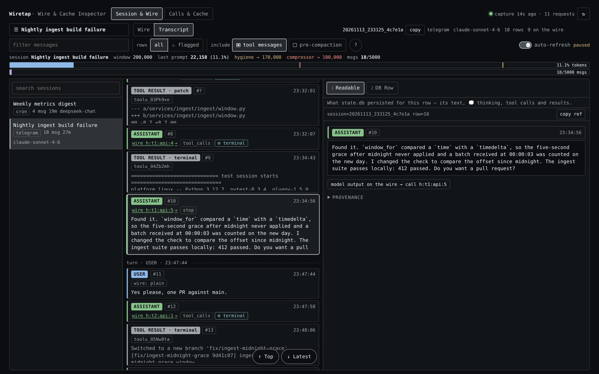
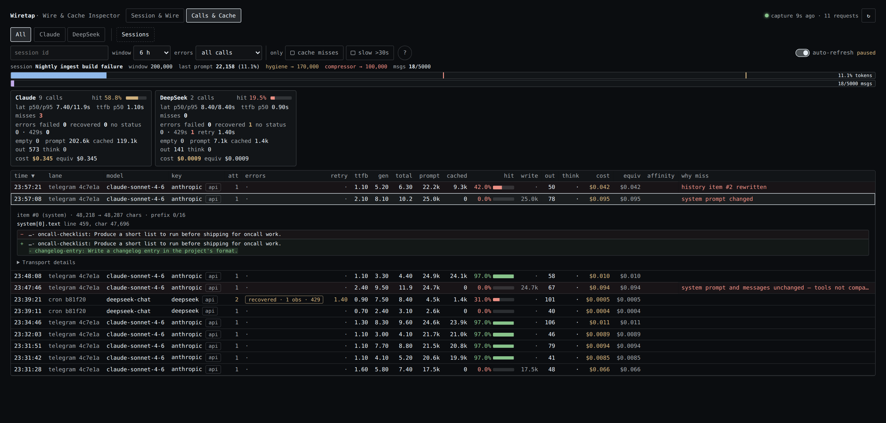

# Wiretap

See what your agents actually see.

Wiretap is a [Hermes Agent](https://github.com/NousResearch/hermes-agent) plugin that records the request
Hermes hands its provider client for each model call and the response that came back, and lets you read both
next to the stored transcript. For any captured call you can open the compiled request (the system prompt,
every message in order with whatever Hermes added at send time, and the tool declarations and parameters as
far as Hermes passes them to plugins) followed by the model's text, reasoning summary and tool calls. A second
view lists calls with latency, tokens, prefix-cache hit rate and cost, and says what changed when the cache
missed; a read-only CLI covers the same data. Everything is stored on your machine and nothing is sent
anywhere.

Capture uses Hermes's API-request hooks and nothing else. Wiretap wraps no HTTP client, changes no request
and runs no code from outside this repository. The limits that follow from that are listed under
[What the hooks do not show](#what-the-hooks-do-not-show).


*Session & Wire, Wire mode. Call #9 of a session, captured from the hooks: the system prompt (it matches what
`state.db` stored), 12 tool declarations as Hermes's hook copy carried them, five more envelope keys, then
the message items in order. Item #0, a user message that arrived from Telegram, is open in the Readable tab.
The text `state.db` stored for that row is plain. What Hermes put on the message it sent to the model is
tinted and labelled: a timestamp and a `[Triggering message id: …]` note above the text, and below it a
`<memory-context>` block and a system note.*

The screenshots show a synthetic demo dataset. It was captured through the plugin's hooks from Hermes's own
hook call sites and rendered from the dashboard bundle in headless Chromium, outside the frame of the Hermes
dashboard. Names, IDs and paths are invented, and costs are list-price estimates.

## Install

```bash
hermes plugins install https://github.com/aka-lacie/hermes-wiretap
```

This clones the tip of the default branch into the active profile's plugin folder. Hermes notes that a Git URL
is not a reviewed catalog entry and, in a terminal, asks `Enable 'wiretap' now? [y/N]`. Answer `y`, or use one
of these:

```bash
hermes plugins install https://github.com/aka-lacie/hermes-wiretap --enable   # install and enable, no prompt
hermes plugins enable wiretap                                                  # enable later
```

Add `--ref <40-character commit SHA>` to install one exact commit.

After an enable, Hermes loads the plugin into a running gateway when it can and prints a hint when a restart
is needed. Capture begins with the next model call made by a process that has loaded the plugin. If no calls
show up, restart:

```bash
hermes gateway restart     # CLI users: start a new `hermes` session instead
```

Then open the web dashboard (`hermes dashboard`) and pick the **Wiretap** tab. In Hermes Desktop the package
also has a Desktop half: a Wiretap page at `/wiretap` and an **Open Wiretap** command. Check that its switch is
on in the Desktop plugin list.

Installing by catalog name, `hermes plugins install wiretap`, works only after this plugin's catalog entry has
been merged into Hermes. Until then a bare name is an error; use the URL.

## What you can do

### Read the request

**Session & Wire → Wire** shows one call at a time.

- **Request layers.** The system prompt, with a chip that says whether it matches the prompt `state.db`
  stored for the session; the tool declarations by name, when Hermes's hook copy carried them; the remaining
  envelope keys; then every message item in order with its role, its size and the transcript row it renders.
- **What was added at send time.** The Readable tab shows an item's text as captured. Text that matches the
  row stored in `state.db` is plain. Text around it that the row does not contain, such as Hermes's own
  envelope notes or XML-style wrapper tags, is tinted and labelled.
- **Wire JSON.** The second detail tab is the captured request as a JSON tree, expanded and scrolled to the
  selected item.
- **The response.** After the last request item comes the call's model output: finish reason, output tokens,
  reasoning, tool calls and text.
- **Stepping through calls.** The call selector lists the session's captured calls, and the `‹` `›` buttons
  move to the previous and next one. The newest conversational call is selected by default. Calls made by a
  Hermes background review are marked `[review]`. Transcript rows written after the selected call are listed
  as "not yet on the wire".

On today's Hermes every captured call carries an "envelope from hook copy" chip: its messages and system
prompt are complete, and its tools and parameters are what Hermes's size-capped copy contained.

### Line it up with the transcript

**Session & Wire → Transcript** lists the rows `state.db` persisted, each labelled with where it came from:
user message, parent assignment, subagent completion, webhook or cron notice, compaction summary, assistant,
tool result. These labels are inferred from the row's text. Detail tabs are Readable and DB Row (every column
of the raw row). An assistant row links to the call that produced it, so you can jump from a reply to the
request behind it.

Filters: free text, flagged rows (an automatic hint, such as a reply that describes a tool result that never
arrived; not a confirmed error), tool messages, and rows that compaction removed.



*Session & Wire, Transcript mode. The rows `state.db` persisted. The selected assistant row links to the call
that produced it, `h:t1:api:5`, and the right pane shows what was stored for the row.*

### Calls & Cache



*Calls & Cache. Eleven calls of two sessions on two providers; one recovered from a 429. Three are cache
misses, each with a different verdict. "system prompt changed" is expanded: the evidence names
`system[0].text`, line 459, and shows the line that was added. "history item #2 rewritten" is an old tool
result that was trimmed. The third reads in full "system prompt and messages unchanged — tools not compared
(hook copy)": nothing Wiretap can compare had changed.*

- One row per call: time, lane, model, attempts, errors, time to first byte, generation time, total time,
  prompt and cached tokens, hit rate, cache-write, output and reasoning tokens, cost, list-price equivalent,
  and a "why miss" verdict.
- A summary card per model family, and filters for the time window, errors, cache misses (prompt over 20k
  tokens with under 50% cached) and slow calls (over 30 seconds).
- Miss forensics. For a miss, Wiretap compares the request with the closest earlier call of the same session,
  model family and lane, finds the first system-prompt or message item that differs and shows a bounded window
  around the change. When both are unchanged it says "system prompt and messages unchanged — tools not
  compared (hook copy)": the cause is then a change in the tool declarations, which today's hooks do not let
  it see, or a miss on the provider's side. It cannot see inside a provider's cache.
- Per-call signals read from the response: provider fallbacks, refusals, safety blocks, and a served model
  that differs from the requested one.
- A context gauge for the selected session: its last prompt size against the model window and the profile's
  compression thresholds.

### CLI

The plugin registers `hermes wiretap`, a read-only command over the same stores. It opens both databases
read-only and never migrates or writes.

```bash
hermes wiretap status                                             # store paths, sizes, capture freshness
hermes wiretap sessions list --since 6h
hermes wiretap session show SESSION_ID --compiled --limit 8       # newest request, items aligned to rows
hermes wiretap calls list --misses --since 1d                     # cache misses with their verdicts
hermes wiretap call show CALL_ID --request --response --diff      # one call; ID may be a unique substring
hermes wiretap search "text you expect in a request" --request --since 1d
hermes wiretap costs --since 1d --by model
```

Output is short text by default. `--json` prints one JSON document, and `--jsonl` one object per result for the
list and search commands. Request output is bounded unless you pass `--full`; `--items START:END` and
`--item N` select parts of a request. Every subcommand has `--help`.

The same CLI is available without Hermes as `bin/wiretap` in the installed plugin directory. It needs only a
Python 3.10+ interpreter and finds the stores through `--home <HERMES_HOME>`, `--telemetry-db` / `--state-db`,
or the `TELEMETRY_DB` / `WIRETAP_STATE_DB` / `HERMES_HOME` environment variables.

## How capture works

Wiretap registers three Hermes hooks and reads only the arguments Hermes passes to them:

| hook | what it records |
| --- | --- |
| `pre_api_request` | the compiled request: system prompt, every message item, the envelope keys Hermes passes |
| `post_api_request` | the response (text, reasoning, tool calls, finish reason), usage, timing |
| `api_request_error` | status, retry counters and a truncated error message per failed attempt |

`pre_api_request` receives the message list (`request_messages`) and the system prompt (`system_prompt`) as
Hermes's own objects, and the rest of the request as `request`, a sanitized copy with a size cap. Wiretap
stores the first two in full and takes the tools and parameters from the copy.

Wiretap also reads two arguments that no Hermes release passes yet; they have been proposed to Hermes.
`request_tools` is the request's own tool list at the point the hook fires. When a hook receives it, the
call's tools are stored from it, the chip reads "parameters from hook copy", and tool declarations are
compared between calls, so a miss can be reported as "tool declarations changed" with the field that differs.
`request_params` is the rest of the request outside the size cap; with both, the capture is complete and
carries no chip. Without them nothing changes.

The hook does its work inside the turn only as far as taking a snapshot: it serializes the request so that
later changes to Hermes's lists cannot alter the record, then hands it to one background writer thread. A
full queue drops the capture instead of blocking, and every error is swallowed, so a capture failure does
not fail a model call. The payload of a request larger than `max_request_mb` is not captured.

Request items are stored content-addressed: one compressed blob per message or envelope key, so a long history
shared by consecutive calls is stored once.

### What the hooks do not show

- **Complete tools and parameters.** Hermes shortens long strings and long lists in the `request` copy and
  cuts deeply nested values, such as the `items` schema of an array parameter in an OpenAI-format tool. It
  replaces the whole copy with a preview when even the shortened request, messages included, is larger than
  its cap (50,000 characters by default). For such a call Wiretap stores no tools and no parameters, only
  the model name, the system prompt and the messages. A session with many tools or a long history will
  usually be over the cap.
- **Tool changes as the cause of a cache miss.** The copy is cut differently from one call to the next as a
  conversation grows, so the stored tools of two calls can differ when the tools did not. Wiretap therefore
  never compares tool declarations that came from the copy.
- **What happens after the hook.** The hook fires when Hermes has built the request. A plugin's LLM execution
  middleware can still replace it, and the provider SDK, a provider adapter or another plugin's client wrapper
  can still change it. Those changes, the serialized body and the HTTP headers are not visible to a hook and
  are not recorded. The Wire view shows the request at the point the hook fires.
- **Auxiliary calls.** Title generation, context compression, vision and other side calls do not fire these
  hooks, so they are not recorded.

## What is stored, where, and for how long

- **Where.** `$HERMES_HOME/plugin-data/wiretap/telemetry.db`, a SQLite database. The directory is set to mode
  `0700` and the database files to `0600`.
- **What.** With `capture_payloads` on (the default): the request and response of every model call as
  described above, which includes your prompts, tool results and the model's replies, verbatim. Also one row
  of numbers per call (timing, tokens, cache, cost, status), which Wiretap still records when payloads are off.
- **Redaction.** Before anything is queued, `api_key`, `authorization`, cookies, keys ending in `_api_key`,
  `_secret` or `_token`, and credential-bearing headers are replaced with a redaction marker. Base URLs lose
  user-info and query strings. Message content is not redacted. Treat the file like your session store.
- **Retention.** Captured payloads older than `retention_hours` (72 by default) are deleted by the writer.
  The per-call number rows are kept.
- **Network.** Nothing is uploaded. Wiretap has no HTTP client, socket or subprocess code of its own, and the
  UI calls only the plugin's own API through the host SDK. The list-price estimate asks Hermes's pricing
  module, which for calls routed through OpenRouter downloads OpenRouter's public model list (a plain GET,
  cached by Hermes for an hour).
- **Reads.** Hermes's session store `state.db` is opened read-only (`mode=ro`, `query_only`). Wiretap never
  creates or migrates it.

### Settings

Under `plugins.entries.wiretap.settings` in the profile config. All are optional.

| key | default | meaning |
| --- | --- | --- |
| `enabled` | `true` | record the per-call number rows (never content) |
| `capture_payloads` | `true` | also store requests and responses; turn off to keep numbers only |
| `retention_hours` | `72` | delete captured payloads older than this |
| `max_request_mb` | `64` | skip payload capture for a larger request |

## Disclosures

What a user or a catalog reviewer should know before installing.

- **Local storage of conversation content.** Prompts, tool results and responses are written to the database
  above and kept for 72 hours by default. Set `capture_payloads: false` to store numbers only.
- **Reads outside the plugin's own data.** `state.db`, read-only. The profile's Hermes config, through
  Hermes's config loader, for the plugin's own settings and the `compression` thresholds the context gauge
  shows. If `plugin-data/wiretap/telemetry.db` does not exist but a database left by the plugin's former name
  (`plugin-data/model-telemetry/`) does, that one is used.
- **Hermes hooks.** `pre_api_request`, `post_api_request`, `api_request_error`. It also registers the
  `hermes wiretap` CLI command and, for the dashboard, GET-only routes under `/api/plugins/wiretap/`. It
  registers no tools and no middleware.
- **No interception.** The plugin wraps or replaces no function of Hermes or of any library, reads no state
  of its caller, and adds nothing to any request. It executes no Python file other than its own modules.
- **Hook arguments outside the hook reference.** Three arguments Hermes passes today are not in its hook
  tables: `system_prompt` on `pre_api_request`, and `first_chunk_at` and `context_length` on
  `post_api_request`. If one stops arriving, the system prompt of Anthropic and Responses requests is cut or
  missing, or time to first byte or the context gauge's window goes blank; capture continues. Two more,
  `request_tools` and `request_params` on `pre_api_request`, are not passed by Hermes at all yet; they are
  used when present and their absence changes nothing.
- **Private Hermes imports.** `hermes plugins validate` passes with one warning that lists them:
  `agent.usage_pricing` (in `collector/store.py`), used for the list-price cost estimate, including two of
  its underscore-prefixed lookup helpers as a fallback; and `tools.skill_provenance.get_current_write_origin`
  (in `collector/capture.py`), read to label background-review calls. If either moves, cost columns show a
  dash or review calls lose their label; capture continues. The pricing sources that Hermes module consults
  are Hermes's own, including the OpenRouter model list named under Network above. The plugin also imports
  `hermes_constants` (for the profile home) and `hermes_cli.config` (the read-only config loader), which the
  validator does not flag.
- **Background work.** One daemon writer thread per Hermes process, started with the first capture. No
  separate service, no child processes.
- **Credentials.** None are stored. Secrets in the request envelope are redacted before the request is
  queued, the plugin reads no credential files, and it identifies calls by Hermes's provider and model names.
- **No usage reporting and no self-update.** The word "telemetry" in file names refers to the local per-call
  rows.
- **Columns this package never fills.** The store and the readers still have columns for a proxy's view of a
  call (upstream request, serving credential, project, per-attempt upstream errors), and `collector/inspector.py`
  can parse a proxy request log it is handed. Nothing in this package calls that parser or writes those
  columns. The CLI flags `--upstream` and `--project` therefore have nothing to match, `--credential` matches
  only the provider name, and those columns in the UI stay empty.

## Requirements and compatibility

- Hermes Agent `>=0.22.5` (`requires_hermes` in `plugin.yaml`). No Python dependencies beyond what Hermes
  ships.
- The Wiretap tab needs the web dashboard; the Wiretap page needs Hermes Desktop. The hooks and the CLI work
  without either.
- Capture is driven by Hermes's hooks and does not depend on the provider. The request shapes handled are
  `messages` and `input` (OpenAI chat, Responses, Anthropic Messages).
- The plugin must run inside the Hermes process, which is the default. `plugins.isolation: host` has not been
  tested.
- `state.db` is read by column name, so an older session schema shows the missing fields blank.
- A session titled exactly `Bot Chat`, or the one named by the `MAIN_SESSION` environment variable, is pinned
  first in the session list. Otherwise the list is by recent activity.

## Development

The repository root is the plugin directory. The tests need a Hermes checkout and a Python that can import
Hermes and its dependencies, for example the virtualenv of a Hermes install.

```bash
git clone https://github.com/aka-lacie/hermes-wiretap && cd hermes-wiretap
export PYTHONPATH=/path/to/hermes-agent
export HERMES_HOME="$(mktemp -d)"                 # never point the tests at a real profile
export WIRETAP_JSDOM_DIR=/path/to/hermes-agent    # optional: a directory whose node_modules has jsdom and react-dom
export PYTHONDONTWRITEBYTECODE=1

uv run --with pytest --python /path/to/hermes/venv/bin/python --no-project pytest tests -q -p no:cacheprovider -rs
node tests/test_dashboard.mjs dashboard/dist/index.js "$WIRETAP_JSDOM_DIR"
python3 desktop/build.py --check                  # the Desktop bundle matches the dashboard source
```

Expected: 168 passed, 1 skipped, or 169 passed with Playwright and Chromium configured
(`WIRETAP_PLAYWRIGHT_DIR`, `WIRETAP_CHROMIUM`) for the one browser layout test. Checked against Hermes `main`
at commit `882cbc9` on 2026-11-13. No test makes a model request or needs a running Hermes, and the suite
passes without network access. With network access, Hermes's pricing module may download OpenRouter's public
model list for the fixtures that use the `openrouter` provider.

`desktop/plugin.js` is generated from `desktop/entry.js`, `dashboard/dist/index.js` and the two stylesheets.
After editing any of them, run `python3 desktop/build.py`.

The catalog check is `hermes plugins validate /path/to/hermes-wiretap --install-deps`.

## Repository layout

```text
.
├── README.md
├── LICENSE                     MIT
├── plugin.yaml                 manifest: name, version, requires_hermes, hooks, settings
├── __init__.py                 hook registration, settings, CLI command registration
├── bin/
│   └── wiretap                 launcher for the CLI without Hermes
├── collector/
│   ├── capture.py              hook handlers, background writer
│   ├── store.py                paths, SQLite schema, content-addressed blobs, retention, pricing
│   ├── inspector.py            transcript classification, request/transcript alignment, request views, search
│   ├── forensics.py            first-difference evidence for cache misses
│   ├── signals.py              fallbacks, refusals, safety blocks, model switches
│   ├── telemetry.py            read API for the Calls view and the CLI
│   └── cli.py                  the `wiretap` command
├── dashboard/
│   ├── manifest.json           dashboard tab declaration
│   ├── plugin_api.py           read-only FastAPI routes
│   └── dist/
│       ├── index.js            the UI for both the dashboard tab and the Desktop page
│       └── style.css
├── desktop/
│   ├── plugin.js               generated Desktop entry
│   ├── entry.js                Desktop adapter source
│   ├── desktop-theme.css
│   ├── build.py                builds and checks plugin.js
│   └── test-native.mjs         Desktop entry test
├── docs/
│   ├── ERRORS.md               contract of the per-call error_summary object
│   └── screenshots/            the three images in this README
└── tests/
    ├── test_*.py               24 Python test modules
    ├── test_dashboard.mjs      UI tests under jsdom
    └── test_layout.mjs         browser layout tests (Playwright)
```

## Licence

MIT. See [LICENSE](LICENSE).
