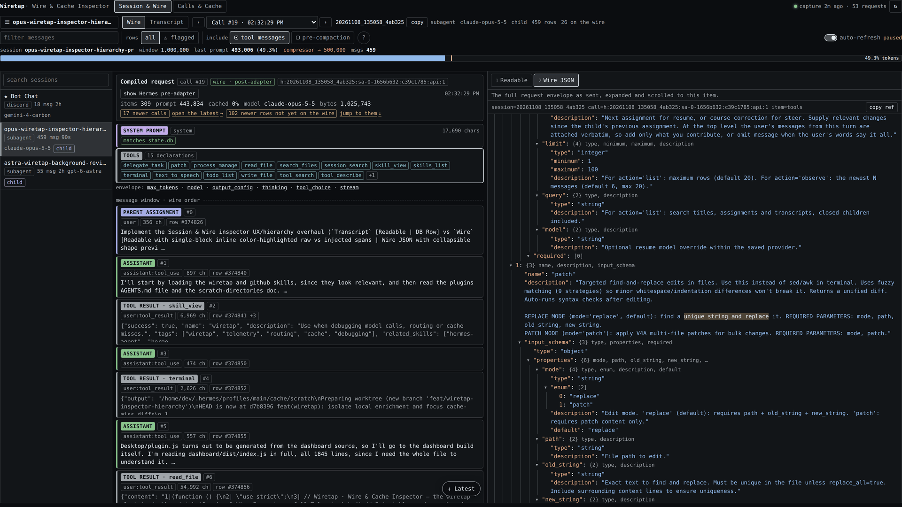

# Wiretap

See what your agents actually see.

Wiretap is a [Hermes Agent](https://github.com/NousResearch/hermes-agent) plugin that records the exact
request each model call put on the wire and the response that came back, and lets you read both next to the
stored transcript. For any captured call you can open the compiled request (the system prompt, the tool
schemas, every message in order, and whatever the harness or a provider adapter added at send time) followed
by the model's text, reasoning summary and tool calls. A second view lists calls with latency, tokens,
prefix-cache hit rate and cost, and shows a before/after diff when the cache missed; a read-only CLI covers
the same data. Everything is stored on your machine and nothing is sent anywhere.


*Session & Wire, Wire mode. Call #9 of a session: the request's system prompt (it matches what `state.db`
stored), 11 tool declarations, one more envelope key, then the message items in wire order. Item #0, a user
message that arrived from Discord, is open in the Readable tab. The text `state.db` stored for that row is
plain. What Hermes put on the message it sent to the model, but not in the row's stored text, is tinted and
labelled: a timestamp and the `[Triggering message id: …]` note above the text, and below it a
`<memory-context>` block and a note that a skill became available.*

The screenshots show a scrubbed demo dataset: names, IDs and paths are stand-ins, and costs are list-price
estimates, not amounts anyone was billed.

## Install

```bash
hermes plugins install https://github.com/aka-lacie/hermes-wiretap
```

This clones the tip of the default branch into the active profile's plugin folder. Hermes notes that a Git URL
is not a reviewed catalog entry and, in a terminal, asks `Enable 'wiretap' now? [y/N]`. Answer `y`, or use one
of these:

```bash
hermes plugins install https://github.com/aka-lacie/hermes-wiretap --enable   # install and enable, no prompt
hermes plugins enable wiretap                                                  # enable later
```

Add `--ref <40-character commit SHA>` to install one exact commit.

After an enable, Hermes loads the plugin into a running gateway when it can and prints a hint when a restart
is needed. Capture begins with the next model call made by a process that has loaded the plugin. If no calls
show up, restart:

```bash
hermes gateway restart     # CLI users: start a new `hermes` session instead
```

Then open the web dashboard (`hermes dashboard`) and pick the **Wiretap** tab. In Hermes Desktop the package
also has a Desktop half: a Wiretap page at `/wiretap` and an **Open Wiretap** command. Check that its switch is
on in the Desktop plugin list.

Installing by catalog name, `hermes plugins install wiretap`, works only after this plugin's catalog entry has
been merged into Hermes. Until then a bare name is an error; use the URL.

## What you can do

### Read the request on the wire

**Session & Wire → Wire** shows one call at a time.

- **Request layers.** The system prompt, with a chip that says whether it matches the prompt `state.db`
  stored for the session; the tool declarations by name; the remaining envelope keys; then every message
  item in wire order with its role, its size and the transcript row it renders.
- **What was added at send time.** The Readable tab shows an item's exact wire string. Text that matches the
  row stored in `state.db` is plain. Text around it that the row does not contain, such as Hermes's own
  envelope notes or XML-style wrapper tags, is tinted and labelled.
- **Wire JSON.** The second detail tab is the full request envelope as sent, expanded and scrolled to the
  selected item.
- **The response.** After the last request item comes the call's model output: finish reason, output tokens,
  reasoning, tool calls and text.
- **Stepping through calls.** The call selector lists the session's captured calls, and the `‹` `›` buttons
  move to the previous and next one. The newest conversational call is selected by default. Calls made by a
  Hermes background review are marked `[review]`. Transcript rows written after the selected call are listed
  as "not yet on the wire".
- **Two copies of a request.** When both were captured, "show Hermes pre-adapter" switches from the body that
  left the process to the request Hermes handed its provider client.

### Line it up with the transcript

**Session & Wire → Transcript** lists the rows `state.db` persisted, each labelled with where it came from:
user message, parent assignment, subagent completion, webhook or cron notice, compaction summary, assistant,
tool result. On a stock Hermes session store these labels are inferred from the row's text. Detail tabs are
Readable and DB Row (every column of the raw row). An assistant row links to the call that produced it, so you
can jump from a reply to the request behind it.

Filters: free text, flagged rows (an automatic hint, such as a reply that describes a tool result that never
arrived; not a confirmed error), tool messages, and rows that compaction removed.

### Calls & Cache


*Calls & Cache, filtered to one session. The expanded call sent 443.8k prompt tokens with 0% cached, $2.23 at
list price, and the verdict is "tool declarations changed". The evidence names the field,
`tools[1].description`, and shows the text before and after. The `key` column shows the provider and the
billing mode.*

- One row per call: time, lane, model, attempts, errors, time to first byte, generation time, total time,
  prompt and cached tokens, hit rate, cache-write, output and reasoning tokens, cost, list-price equivalent,
  and a "why miss" verdict.
- A summary card per model family, and filters for the time window, errors, cache misses (prompt over 20k
  tokens with under 50% cached) and slow calls (over 30 seconds).
- Miss forensics. For a miss, Wiretap compares the request with the closest earlier call of the same session,
  model family and lane, finds the first field that differs and shows a bounded window around the change.
  When the prefix is unchanged it says so and reports a provider-side miss. It cannot see inside a provider's
  cache.
- Per-call signals read from the response: provider fallbacks, refusals, safety blocks, and a served model
  that differs from the requested one.
- A context gauge for the selected session: its last prompt size against the model window and the profile's
  compression thresholds.

The call from that screenshot, opened in Wire → Wire JSON:



*The same call in Wire mode. The Wire JSON tab is open at `tools[1]`, the `patch` tool, whose description is
the field the miss evidence pointed to.*

### CLI

The plugin registers `hermes wiretap`, a read-only command over the same stores. It opens both databases
read-only and never migrates or writes.

```bash
hermes wiretap status                                             # store paths, sizes, capture freshness
hermes wiretap sessions list --since 6h
hermes wiretap session show SESSION_ID --compiled --limit 8       # newest request, items aligned to rows
hermes wiretap calls list --misses --since 1d                     # cache misses with their verdicts
hermes wiretap call show CALL_ID --request --response --diff      # one call; ID may be a unique substring
hermes wiretap search "text you expect on the wire" --request --since 1d
hermes wiretap costs --since 1d --by model
```

Output is short text by default. `--json` prints one JSON document, and `--jsonl` one object per result for the
list and search commands. Request output is bounded unless you pass `--full`; `--items START:END` and
`--item N` select parts of a request. Every subcommand has `--help`.

The same CLI is available without Hermes as `bin/wiretap` in the installed plugin directory. It needs only a
Python 3.10+ interpreter and finds the stores through `--home <HERMES_HOME>`, `--telemetry-db` / `--state-db`,
or the `TELEMETRY_DB` / `WIRETAP_STATE_DB` / `HERMES_HOME` environment variables.

## How capture works

Wiretap registers three Hermes hooks:

| hook | what it records |
| --- | --- |
| `pre_api_request` | the compiled request: system prompt, tools and other envelope keys, every message item |
| `post_api_request` | the response (text, reasoning, tool calls, finish reason), usage, timing |
| `api_request_error` | status, retry counters and a truncated error message per failed attempt |

Two further steps make the stored request exact rather than approximate. Both are listed again under
[Disclosures](#disclosures).

1. **The envelope.** Hermes passes hooks the raw messages and the system prompt, but the rest of the payload
   (tools, sampling parameters) only as a size-capped sanitized copy. To store the real envelope, the hook
   walks up the call stack to Hermes's own call site and reads its `api_kwargs` variable. It accepts that
   variable only if its first and last messages are the same objects the hook was given, and it does not
   modify it. If the variable is not found, the envelope is rebuilt from the documented hook arguments and
   the call is marked "envelope reconstructed" in the UI. Messages and system prompt are exact either way.
2. **The body that left the process.** A provider adapter or another plugin can still rewrite the request
   after the hook runs. Wiretap wraps httpx's last step before the transport and copies the JSON body of a
   request it can attribute to a call in progress. Attribution uses the call's newest message (its tool-call
   id, or a run of its text) and is checked again before the body is stored. A body that cannot be attributed
   is not stored on the call; the call keeps the hook copy and a `tap_miss` reason that
   `hermes wiretap call show` prints. Clients that do not use httpx keep the hook copy only.

The hook does its work inside the turn only as far as taking a snapshot: it serializes the request so that
later changes to Hermes's lists cannot alter the record, then hands it to one background writer thread. A
full queue drops the capture instead of blocking, and every error is swallowed, so a capture failure does
not fail a model call. The payload of a request larger than `max_request_mb` is not captured.

Request items are stored content-addressed: one compressed blob per message or envelope key, so a long history
shared by consecutive calls is stored once.

## What is stored, where, and for how long

- **Where.** `$HERMES_HOME/plugin-data/wiretap/telemetry.db`, a SQLite database. The directory is set to mode
  `0700` and the database files to `0600`.
- **What.** With `capture_payloads` on (the default): the full request and response of every model call,
  which includes your prompts, tool results and the model's replies, verbatim. Also one row of numbers per
  call (timing, tokens, cache, cost, status), which Wiretap still records when payloads are off.
- **Redaction.** Before anything is queued, `api_key`, `authorization`, cookies, keys ending in `_api_key`,
  `_secret` or `_token`, and credential-bearing headers are replaced with a redaction marker. Base URLs lose
  user-info and query strings. Message content is not redacted. Treat the file like your session store.
- **Retention.** Captured payloads older than `retention_hours` (72 by default) are deleted by the writer.
  The per-call number rows are kept.
- **Network.** Nothing is uploaded. Wiretap has no HTTP client, socket or subprocess code of its own, and the
  UI calls only the plugin's own API through the host SDK.
- **Reads.** Hermes's session store `state.db` is opened read-only (`mode=ro`, `query_only`). Wiretap never
  creates or migrates it.

### Settings

Under `plugins.entries.wiretap.settings` in the profile config. All are optional.

| key | default | meaning |
| --- | --- | --- |
| `enabled` | `true` | record the per-call number rows (never content) |
| `capture_payloads` | `true` | also store full requests and responses; turn off to keep numbers only |
| `retention_hours` | `72` | delete captured payloads older than this |
| `max_request_mb` | `64` | skip payload capture for a larger request |

`plugin.yaml` also declares `proxy_log_dir`, `proxy_poller` and `poll_interval`. They belong to an optional
proxy-log module that is not in this repository, and they do nothing here.

## Disclosures

What a user or a catalog reviewer should know before installing.

- **Local storage of conversation content.** Full prompts, tool results and responses are written to the
  database above and kept for 72 hours by default. Set `capture_payloads: false` to store numbers only.
- **Reads outside the plugin's own data.** `state.db`, read-only. The profile's Hermes config, through
  Hermes's config loader, for the plugin's own settings and the `compression` thresholds the context gauge
  shows. If `plugin-data/wiretap/telemetry.db` does not exist but a database left by the plugin's former name
  (`plugin-data/model-telemetry/`) does, that one is used.
- **Hermes hooks.** `pre_api_request`, `post_api_request`, `api_request_error`. It also registers the
  `hermes wiretap` CLI command and, for the dashboard, GET-only routes under `/api/plugins/wiretap/`. It
  registers no tools and no middleware.
- **Reading a caller's frame.** As described above, the `pre_api_request` hook reads the `api_kwargs` local
  variable of Hermes's call site (`sys._getframe`, read-only, verified by object identity). This is not a
  public Hermes interface. If the call site changes, capture falls back to the documented hook arguments.
- **Wrapping httpx.** At load, the plugin replaces `httpx.Client._send_single_request` and
  `httpx.AsyncClient._send_single_request` with wrappers that look at the outgoing request and then call the
  original. This affects every httpx client in the Hermes process. For requests it cannot attribute to a
  model call in progress the wrapper does nothing. No Hermes function, method or module attribute is
  replaced.
- **One added request header.** When a model call goes to a loopback address (a local proxy or a local model
  server), the wrapper adds an `X-Wiretap-Call: <call id>~<nonce>` header to that request. It adds nothing to
  requests sent to other hosts. `WIRETAP_PROXY_HOSTS` can name further hosts to treat the same way.
- **Private Hermes imports.** `hermes plugins validate` passes with one warning that lists them:
  `agent.usage_pricing` (in `collector/store.py`), used for the list-price cost estimate, including two of
  its underscore-prefixed lookup helpers as a fallback; and `tools.skill_provenance.get_current_write_origin`
  (in `collector/capture.py`), read to label background-review calls. If either moves, cost columns show a
  dash or review calls lose their label; capture continues. Whatever pricing sources that Hermes module
  consults are Hermes's own. The plugin also imports `hermes_constants` (for the profile home) and
  `hermes_cli.config` (the read-only config loader), which the validator does not flag.
- **Background work.** One daemon writer thread per Hermes process, started with the first capture. No
  separate service, no child processes.
- **Credentials.** None are stored. Secrets in the request envelope and headers are redacted before the
  request is queued, the plugin reads no credential files, and it identifies calls by Hermes's provider and
  model names.
- **No usage reporting and no self-update.** The word "telemetry" in file names refers to the local per-call
  rows.
- **Not included.** The code has optional extension points that look for files in an `extensions/` directory:
  proxy-log enrichment, credential labels and a typed session-schema adapter. This repository contains no
  `extensions/` directory, so none of them loads. As a result the CLI flags `--upstream` and `--project` have
  nothing to match, `--credential` matches only the provider name, and the proxy columns in the UI stay empty.
  The description strings in `plugin.yaml` and `dashboard/manifest.json` still mention optional proxy-log
  enrichment; it is not part of this package.

## Requirements and compatibility

- Hermes Agent `>=0.22.5` (`requires_hermes` in `plugin.yaml`). No Python dependencies beyond what Hermes
  ships.
- The Wiretap tab needs the web dashboard; the Wiretap page needs Hermes Desktop. The hooks and the CLI work
  without either.
- Capture is driven by Hermes's hooks and does not depend on the provider. The request shapes handled are
  `messages`, `input` and `contents` (OpenAI chat, Responses, Anthropic Messages, Gemini).
- The exact outgoing body is recorded for provider clients that send through httpx.
- The plugin must run inside the Hermes process, which is the default. `plugins.isolation: host` has not been
  tested, and the frame read and the httpx wrapper are not expected to work there.
- `state.db` is read by column name, so an older session schema shows the missing fields blank.
- A session titled exactly `Bot Chat`, or the one named by the `MAIN_SESSION` environment variable, is pinned
  first in the session list. Otherwise the list is by recent activity.

## Development

The repository root is the plugin directory. The tests need a Hermes checkout and a Python that can import
Hermes and its dependencies, for example the virtualenv of a Hermes install.

```bash
git clone https://github.com/aka-lacie/hermes-wiretap && cd hermes-wiretap
export PYTHONPATH=/path/to/hermes-agent
export HERMES_HOME="$(mktemp -d)"                 # never point the tests at a real profile
export WIRETAP_JSDOM_DIR=/path/to/hermes-agent    # optional: a directory whose node_modules has jsdom and react-dom
export PYTHONDONTWRITEBYTECODE=1

uv run --with pytest --python /path/to/hermes/venv/bin/python --no-project pytest tests -q -p no:cacheprovider -rs
node tests/test_dashboard.mjs dashboard/dist/index.js "$WIRETAP_JSDOM_DIR"
python3 desktop/build.py --check                  # the Desktop bundle matches the dashboard source
```

Expected: 183 passed, 46 skipped, or 184 passed, 45 skipped with Playwright and Chromium configured
(`WIRETAP_PLAYWRIGHT_DIR`, `WIRETAP_CHROMIUM`) for the one browser layout test. Checked against Hermes `main`
at commit `f19432a` on 2026-11-11. The other 45 skips are tests whose fixture is one of the optional modules
this repository does not ship; `tests/conftest.py` and the test modules name the module each one needs. No test
makes a provider request or needs a running Hermes.

`desktop/plugin.js` is generated from `desktop/entry.js`, `dashboard/dist/index.js` and the two stylesheets.
After editing any of them, run `python3 desktop/build.py`.

The catalog check is `hermes plugins validate /path/to/hermes-wiretap --install-deps`.

## Repository layout

```text
.
├── README.md
├── LICENSE                     MIT
├── plugin.yaml                 manifest: name, version, requires_hermes, hooks, settings
├── __init__.py                 hook registration, settings, CLI command registration
├── bin/
│   └── wiretap                 launcher for the CLI without Hermes
├── collector/
│   ├── capture.py              hook handlers, httpx wrapper, background writer
│   ├── store.py                paths, SQLite schema, content-addressed blobs, retention, pricing
│   ├── inspector.py            transcript classification, wire/transcript alignment, wire views, search
│   ├── forensics.py            first-difference evidence for cache misses
│   ├── signals.py              fallbacks, refusals, safety blocks, model switches
│   ├── telemetry.py            read API for the Calls view and the CLI
│   ├── poller.py               gate for the optional proxy-log module (inactive here)
│   └── cli.py                  the `wiretap` command
├── dashboard/
│   ├── manifest.json           dashboard tab declaration
│   ├── plugin_api.py           read-only FastAPI routes
│   └── dist/
│       ├── index.js            the UI for both the dashboard tab and the Desktop page
│       └── style.css
├── desktop/
│   ├── plugin.js               generated Desktop entry
│   ├── entry.js                Desktop adapter source
│   ├── desktop-theme.css
│   ├── build.py                builds and checks plugin.js
│   └── test-native.mjs         Desktop entry test
├── docs/
│   ├── ERRORS.md               contract of the per-call error_summary object
│   └── screenshots/            the three images in this README
├── scripts/
│   └── export_core.py          copies the source files to a new directory without extensions/ or caches
└── tests/
    ├── conftest.py             skips tests whose optional module is absent
    ├── test_*.py               26 Python test modules
    ├── test_dashboard.mjs      UI tests under jsdom
    └── test_layout.mjs         browser layout tests (Playwright)
```

## Licence

MIT. See [LICENSE](LICENSE).
